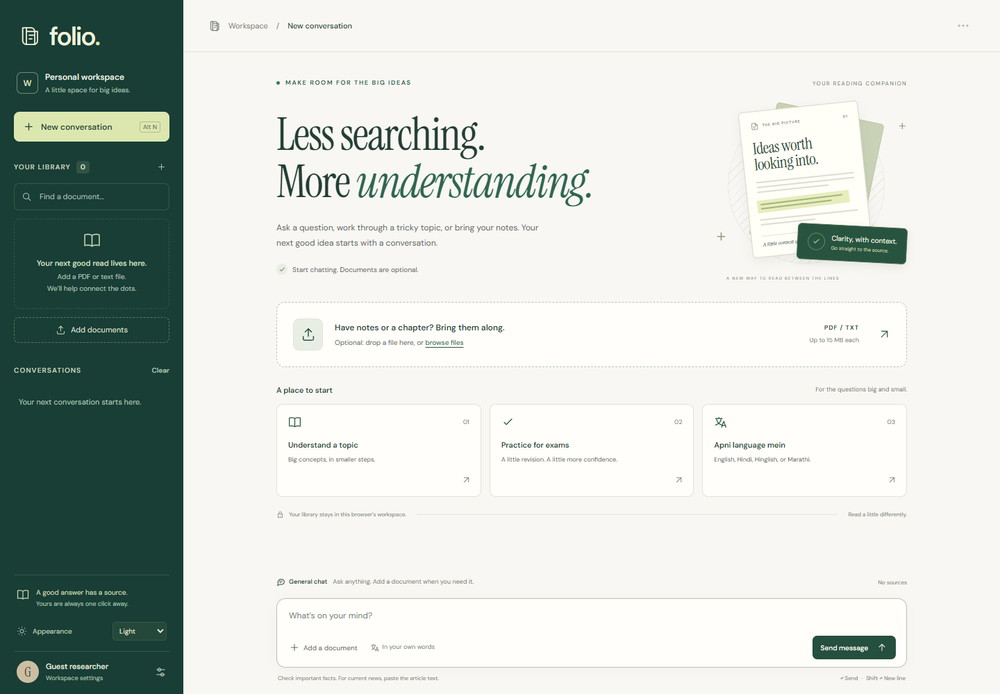

# Folio

A full-stack study and document assistant. Chat without uploading anything, work through a topic, practice for exams, or add a PDF/TXT file for answers with original source passages.

[Open Folio](https://documind-ai-fusionnew-1gbe.onrender.com/) · [Deployment notes](docs/DEPLOYMENT.md)



Python · Django · JavaScript · SQLite · ChromaDB · Sentence Transformers · llama.cpp · Qwen

## What it does

- Normal chat without a PDF or a mode switch.
- Concept explanations, revision help, and one-question-at-a-time exam practice.
- Optional PDF/TXT uploads up to 15 MB, background indexing, duplicate detection, and local OCR for scanned PDFs.
- Multilingual semantic search, physical PDF page references, original passages, and protected source previews.
- Saved conversations, answer export/copy, and local-device text-to-speech when available.
- Responsive light/dark themes with a saved appearance preference.

The default model runs locally, without Gemini or API credits. It uses the existing open-source [Qwen3-4B-Instruct-2507](https://huggingface.co/Qwen/Qwen3-4B-Instruct-2507) model through [llama.cpp](https://github.com/ggml-org/llama.cpp). Folio does not train a new foundation model.

The Render deployment uses hosted Gemma 4 through Google's free API tier, subject to rate limits, using the existing server-side Google API key. Local Qwen mode remains independent of that key. Provider names and setup details stay out of the normal interface.

Render runs multilingual document embeddings locally with pinned INT8 ONNX weights and bounded batches, keeping PyTorch out of its small web process. Local desktop mode can use Sentence Transformers. Changing embedding backends creates a separate index space.

## Windows quick start

Use Python 3.12. Keep an existing `.venv` and `.env`.

```powershell
py -3.12 -m venv .venv
.\.venv\Scripts\python.exe -m pip install -r requirements.txt
Copy-Item .env.example .env
.\.venv\Scripts\python.exe manage.py migrate
.\.venv\Scripts\python.exe manage.py collectstatic --noinput
.\.venv\Scripts\python.exe scripts/setup_local_llm.py
.\.venv\Scripts\python.exe scripts/run_local.py
```

Open **http://127.0.0.1:8003/**. The one-time model download is about 2.5 GB; its runtime and model checksums are verified. The model runs on CPU, so a dedicated GPU is optional. The embedding model is cached on first document upload. See [local model setup](docs/LOCAL_LLM.md) and [OCR setup](docs/OCR.md).

No document selected means normal chat. Uploading/selecting a document uses its evidence. Remove its source chip or start a new conversation to return to normal chat.

## Architecture

```text
Browser → Django views → session-scoped conversations + SQLite
                     → general chat → local Qwen model
                     → document question → embeddings → ChromaDB → local model
                                                              → answer + citations
```

The interface uses Django templates and plain CSS/JavaScript, with no frontend build step. `assistant_app/rag.py` coordinates retrieval; `services/` separates generation, embeddings, OCR, extraction, storage, ownership, and background processing. Gemini remains an optional backend via `LLM_PROVIDER=gemini`; local mode never falls back to a paid provider.

## Checks

```powershell
.\.venv\Scripts\python.exe manage.py check
.\.venv\Scripts\python.exe manage.py test assistant_app
.\.venv\Scripts\python.exe -X utf8 test_rag_pipeline.py
node --check static/assistant_app/workspace.js
node --test scripts/test_speech.cjs scripts/test_workspace_ui.cjs
```

DOM tests use optional jsdom tooling: `npm.cmd install --prefix .local-backup/ui-test-tools --no-save --package-lock=false --ignore-scripts jsdom@27.0.1`. Integration tests use isolated databases and temporary media/vector storage. Live Gemini tests are opt-in and are not required for local mode.

Security controls include workspace ownership checks, CSRF protection, escaped output, a nonce-based script policy, secure production cookies, private file delivery, and request limits for the single-worker demo.

Dependency audit: Pillow, Transformers, and Sentence Transformers were upgraded to patched versions. The scanner still reports ChromaDB HTTP-server/RBAC advisories without an available fix. Folio uses an embedded client, does not expose that HTTP server, and does not accept model repositories from users. This is not a claim of a clean vulnerability scan or a production security certification.

## Practical limits

The small local model can make mistakes. Verify important facts and exam answers; it cannot predict an exam paper. **There is no live news/web search.** Paste an article or upload its text/PDF for a summary; a URL alone is not fetched.

Guest identity depends on browser cookies and is not a cross-device account. Long document summaries sample excerpts. OCR depends on scan quality. The in-process queue and cache suit a small demo; a broader service needs shared rate-limit storage, durable workers, and storage quotas.

See [deployment and public preview](docs/DEPLOYMENT.md). The internal Django package and existing storage keys keep their original names to preserve stored data and preferences.

## Resume description

**Folio — Local Study and Document Assistant**

Built a full-stack Django application with credit-free local LLM inference, multilingual document retrieval, page-level citations, scanned-PDF OCR, session-scoped libraries, saved conversations, and a responsive light/dark interface.
